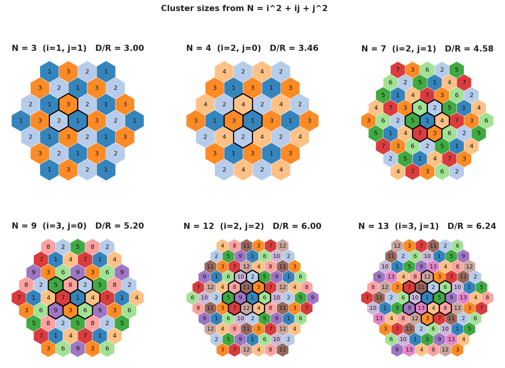

# CellHop Planner

A Python-based wireless communications and networking project that models a cellular mobile system and studies how cluster size, interference, trunking, fading, and frequency-hopping resilience affect system design.

This repository is not a web app or a production service. It is a research-style simulation and reporting toolkit built for a WCN course project: it runs several wireless channel experiments, combines them into one integrated planner, and exports figures, CSV tables, and a final Word report.

<p align="center">
  
</p>

## Why this project exists
The central design question is:

> Which cluster size N should an 84-cell, 300-channel wireless network use when capacity, co-channel interference, fading, and anti-jamming performance are all considered together?

The project answers that question by combining five standard wireless communications topics into one study:

- frequency reuse and hexagonal cell design
- trunking and grade of service (GoS)
- delay spread and coherence bandwidth
- path loss, shadowing, Rayleigh fading, and Doppler effects
- FHSS resilience under AWGN and tone jamming

## What the project includes

### 1) Frequency reuse and cluster geometry
The system models a hexagonal cellular layout using cluster sizes such as 3, 4, 7, 9, 12, and 13. It computes reuse distance and co-channel interference relationships using the classic cellular concept.

### 2) Trunking / Erlang-B analysis
The project evaluates how many users a cell or system can support under a blocking target (1% in the study), using Erlang-B formulas and Monte Carlo validation.

### 3) Multipath propagation analysis
It computes the power delay profile, average power, mean excess delay, RMS delay spread, and coherence bandwidth for different wireless systems like GSM, IS-95, WCDMA, and LTE.

### 4) Fading and mobility analysis
It models large-scale path loss, shadowing, Rayleigh fading, and Doppler effects, then compares simulation results with theoretical values.

### 5) Frequency-hopping spread spectrum (FHSS)
The project simulates an FHSS transmitter/receiver, studies BER under AWGN and jamming, and shows processing-gain and anti-jamming behavior.

### 6) Integrated planner
The unique part of the project combines the experiment results into a design recommendation for the best cluster size under outage constraints.

## Repository layout

```text
wcn_cellhop/
├── main.py                          # Entry point for the full project
├── requirements.txt                 # Python dependencies
├── config/
│   └── settings.py                  # All tunable parameters for every experiment
├── wcn/
│   ├── __init__.py
│   ├── hexgrid.py                   # Hexagonal geometry and cluster math
│   ├── exp1_frequency_reuse.py      # Reuse distance, SIR, cell splitting
│   ├── exp2_trunking_gos.py         # Erlang-B trunking study
│   ├── exp3_multipath.py            # PDP, delay spread, coherence bandwidth
│   ├── exp4_fading.py               # Path loss, shadowing, Rayleigh, Doppler
│   ├── exp5_fhss.py                 # FHSS BER and jammer study
│   ├── integrated_planner.py        # Combines all experiments into one decision
│   ├── report_builder.py            # Builds the final Word report
│   └── utils.py                     # Output and file helpers
├── tests/
│   └── test_core.py                 # Mathematical validation tests
├── docs/
│   └── PAPER_REFERENCES.md          # Papers and references behind the study
├── outputs/
│   ├── figures/                     # PNG charts for each experiment
│   ├── tables/                      # CSV tables from the simulations
│   ├── report/
│   │   └── WCN_CellHop_Report.docx  # Final cumulative report
│   └── results.json                 # Machine-readable summary of results
├── README.md                        # Project overview and usage guide
└── .idea/                           # IDE workspace metadata
```

## Quick start

### Install dependencies

```bash
python -m venv .venv
# Linux / macOS
source .venv/bin/activate
# Windows
.venv\Scripts\activate

pip install -r requirements.txt
```

### Run the full project

```bash
python main.py
```

### Useful options

```bash
python main.py --fast          # reduce Monte Carlo samples for a quicker run
python main.py --interactive   # manually enter multipath delays and powers
python main.py --pdp my.csv    # load PDP data from a CSV file: delay_ns,power_dbm
python main.py --no-report     # skip generating the Word report
```

### Run the tests

```bash
python -m pytest -q
```

The project has validation tests covering Erlang-B calculations, cluster geometry, Doppler/coherence estimates, delay-spread formulas, and FHSS BER behavior.

## Experiment overview

| Experiment | Topic | Main output |
|---|---|---|
| 1 | Frequency reuse and co-channel interference | reuse distance, SIR trends, cell splitting plots |
| 2 | Trunking / Erlang-B | capacity for N = 4, 12, 13 and GoS figures |
| 3 | Power delay profile and delay spread | PDP metrics, coherence bandwidth |
| 4 | Fading and mobility | path loss, Rayleigh fading, Doppler spread |
| 5 | FHSS wireless security / anti-jamming | BER curves under AWGN and tone jamming |
| Integrated planner | Combined network design study | recommended cluster size under outage constraints |

## Important design question the planner answers
The project combines all of the above to answer a single engineering question:

> If the system must support many users while keeping interference and outages under control, which cluster size N gives the best capacity-performance tradeoff?

The answer is not taken from a single formula. It is formed by combining:

- reuse distance and SIR from cellular geometry
- channel capacity via Erlang-B
- outage probability from shadowing/fading models
- hopping diversity and processing gain
- jammer resilience from frequency hopping

## Output files

When you run the project, it generates:

- `outputs/figures/` — all plots and charts
- `outputs/tables/` — CSV result tables
- `outputs/results.json` — structured results
- `outputs/report/WCN_CellHop_Report.docx` — the final report document

These outputs are designed to be used for analysis, writing a technical report, or comparing multiple design choices.

## Configuration

Every parameter is centralized in:

```text
config/settings.py
```

This makes it easy to change things like:

- bandwidth
- cell area
- channel count
- traffic per user
- path-loss exponent
- shadowing variance
- jammer power
- SIR threshold

A single change in settings updates the whole study.

## References

The project uses ideas from classic wireless communication literature, including:

- V. H. MacDonald, "The Cellular Concept"
- R. L. Pickholtz, D. L. Schilling, L. B. Milstein, on spread-spectrum communications
- T. S. Rappaport's wireless communications fundamentals
- Erlang trunking theory and wireless fading literature

Relevant notes are included in:

- `docs/PAPER_REFERENCES.md`

## Validation

This repository includes a mathematical validation suite. Example:

```bash
python -m pytest -q
```

At the time of writing, the suite passes successfully.

## Summary

CellHop Planner is a compact but complete wireless networking simulation project. It demonstrates how to model a cellular network using theory from communication engineering and then turn the results into a design recommendation with plots, tables, and a final written report.

It is a strong example of an applied engineering project: simulation + analysis + validation + reporting.
