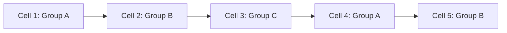
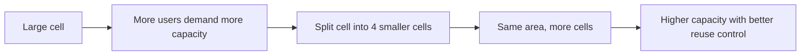

# 1) Frequency Reuse and Hexagonal Cellular Geometry

## The mental model

A cellular system divides a large area into cells. Each cell uses a subset of radio channels, and the same channel can be reused in another cell far away.

Why this matters:
- same frequency reused in distant cells
- nearby cells use different groups
- this reduces interference while keeping spectrum efficient

---

## What it is

Frequency reuse is the idea that the same radio frequency can be used in different cells, provided those cells are far enough apart to keep interference acceptable.

In practice, the system divides available spectrum into groups and assigns each group to different cells in a repeating pattern.

---

## What it does

This concept creates a repeating cell pattern that allows a network to serve many users without giving every cell a completely separate frequency set.

In this project, cells are modeled as hexagons because hexagons approximate coverage areas more realistically than squares.

The cluster size is:

N = i^2 + ij + j^2

That gives common reuse sizes like:

| (i, j) | Cluster size N |
|---|---:|
| (1, 1) | 3 |
| (2, 0) | 4 |
| (2, 1) | 7 |
| (3, 0) | 9 |
| (2, 2) | 12 |
| (3, 1) | 13 |

---

## How it does that

The project does the following:

- creates a hexagonal cell grid
- assigns frequency groups to cells
- uses the (i, j) pair to define the cluster geometry
- measures the reuse distance D between co-channel cells
- compares the measured value with the theory:

D / R = sqrt(3N)

where:
- D = distance between co-channel cells
- R = cell radius
- N = cluster size

This is one of the most important formulas in cellular design.

---

## Why this matters in the project

This is the foundation for the entire network design.

### If N is too small
- frequencies are reused too often
- co-channel interference rises
- system quality drops

### If N is too large
- reuse is more spread out
- fewer users are supported per cell
- overall capacity decreases

So the project studies the best balance between:
- interference
- capacity
- efficiency

---

## Cell splitting idea

The project also simulates cell splitting by reducing the radius and increasing the number of cells in the same region.

---

## Why it matters in the problem statement

This concept directly addresses the main project question:

> Which cluster size should the network use so that it supports many users without too much interference?

The answer depends heavily on how the spectrum is reused across cells.

---

## Simple presentation version

> Frequency reuse means reusing the same channels in different cells as long as those cells are far enough apart. In our project, the system uses a hexagonal cellular layout and tries to choose the best cluster size N so the network has enough capacity without too much interference.

