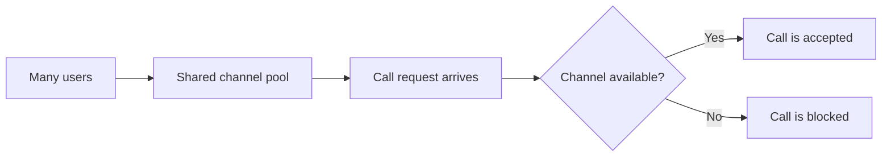

# 2) Trunking and Erlang-B

## The big idea

A cellular network does not give a private channel to every user forever. Instead, many users share a common pool of channels. This is called trunking.

---

## What it is

Trunking means that a set of channels is shared among many users in a statistical way.

The critical question is:

> How many users can the system support before calls are blocked too often?

---

## What it does

The project uses the Erlang-B formula to quantify blocking probability for a channel pool.

This is one of the core formulas in teletraffic engineering.

The formula is:

B(A, C) = (A^C / C!) / sum_{k=0}^{C} (A^k / k!)

where:
- A = offered traffic in Erlangs
- C = number of channels
- B(A, C) = blocking probability

---

## How it does that

The project calculates:

- total channels in the system
- channels per cell after reuse division
- offered traffic per cell
- traffic that can be carried at a target blocking probability
- users per cell and total users in the system

Then it compares the result for different cluster sizes.

---

## Why this matters in the project

A good reuse pattern is not enough on its own. A network can have strong frequency reuse but still fail if too many users are trying to access too few channels.

This concept tells us:
- how much traffic a cell can carry
- how many users can be supported
- which cluster size provides the best capacity under a 1% blocking target

So trunking is essential for the “capacity” side of the project.

---

## Example in this project

The system uses:

- 84 cells
- 300 channels total
- 0.04 Erlang per user
- blocking probability target = 1%

The project studies cluster sizes like:

- N = 4
- N = 12
- N = 13

and checks how many users each design can support.

---

## Why it matters in the problem statement

This is one half of the real design question.

The project is not just asking “How much interference?” It is also asking:

> How many users can the network actually serve while meeting the blocking target?

That is exactly what trunking answers.

---

## Simple presentation version

> Trunking means that a pool of channels is shared among many users. Erlang-B tells us how much traffic a certain number of channels can carry before too many calls are blocked. In this project, it lets us estimate how many users each cell can support and which reuse pattern gives the best capacity with acceptable blocking.

