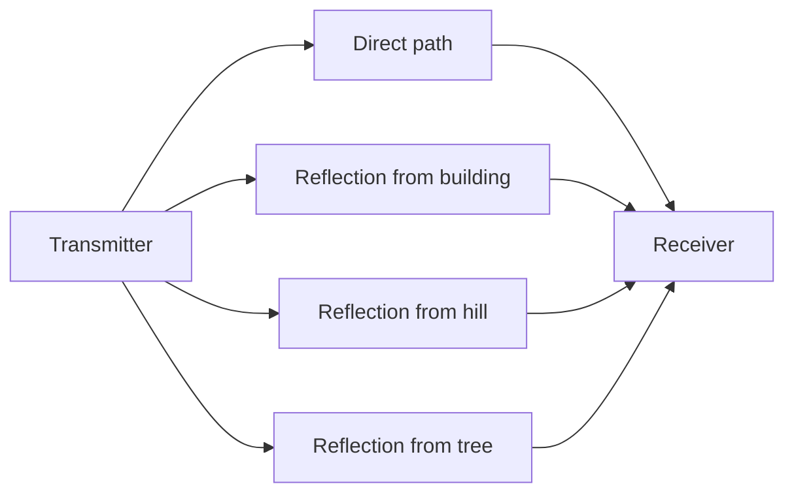

# 3) Multipath Propagation, Delay Spread, and Coherence Bandwidth

## The visual idea

A transmitted signal can reach the receiver by many different paths.

Each path has a different length, so the copies arrive at different times.

---

## What it is

Multipath propagation means the signal arrives at the receiver through multiple paths instead of one direct path.

This happens because radio waves reflect off buildings, vehicles, terrain, and other obstacles.

---

## What it does

Multipath creates a Power Delay Profile (PDP), which shows:
- the delay of each arriving ray
- the power of each ray
- how spread out the signal is in time

The project measures:
- strongest path
- weakest path
- maximum excess delay
- average received power
- mean excess delay
- RMS delay spread

---

## How it does that

The project takes arrays of:
- delay values (ns)
- power values (dBm or W)

Then it computes:

- mean excess delay
- RMS delay spread
- coherence bandwidth

The key formula for RMS delay spread is:

σ = sqrt( (Σ P_i (τ_i - τ_mean)^2) / Σ P_i )

The project then estimates coherence bandwidth using:

Bc ≈ 1 / (5σ)

and a stricter version:

Bc ≈ 1 / (50σ)

---

## Why this matters

Delay spread tells us how much the channel spreads signals in time.

### Small delay spread
- channel is more stable
- less frequency distortion
- system behaves more like a flat channel

### Large delay spread
- different frequencies fade differently
- signal distortion increases
- system becomes more frequency-selective

This is very important in real wireless systems because the channel is not always the same across all frequencies.

---

## Why it matters in the project

This concept is relevant because the network’s performance depends not only on reuse distance and capacity, but also on how the wireless channel behaves across frequency.

It helps answer:
- Is the system flat or frequency-selective?
- Does the environment create strong multipath distortion?
- How much diversity does the channel offer?

---

## Project link to the design question

If the channel is frequency-selective, then the system may require more robust planning and more diversity. This affects how the final design should balance reuse, interference, and resilience.

---

## Simple presentation version

> Multipath propagation occurs because a wireless signal reaches the receiver through many reflected paths. These delayed copies spread the signal in time, which is measured by delay spread. A larger delay spread means the channel is more frequency-selective, and that affects how reliable the network is in a real environment.

