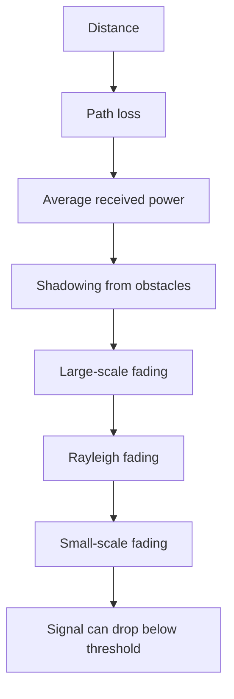

# 4) Fading, Path Loss, Shadowing, and Doppler

## The visual idea

A receiver does not see a stable signal all the time. The signal amplitude changes with distance, obstacles, movement, and multipath.

---

## What it is

Fading is the random variation of received signal strength in a wireless channel.

It can happen because of:
- distance between transmitter and receiver
- buildings and terrain blocking the path
- reflected waves from surrounding objects
- motion of the user or the environment

---

## What it does

The project models several fading effects:

### 1) Path loss
As distance grows, signal power falls.

The model uses:

Pr(d) = P0 - 10n log10(d / d0)

where:
- n = path-loss exponent
- d0 = reference distance
- P0 = power at reference distance

### 2) Shadowing
Obstacles produce random fluctuations around the average path loss, modeled as log-normal fading.

### 3) Rayleigh fading
When there is no dominant line-of-sight path, the signal amplitude follows Rayleigh statistics.

### 4) Doppler effect
When the user is moving, the channel changes over time. This is represented by Doppler spread and coherence time.

---

## How it does that

The project:
- simulates received power at different distances
- adds average path-loss trend
- adds shadowing noise in dB
- adds Rayleigh fading samples
- measures mean, variance, and outage behavior

It also computes Doppler parameters using:

fd = v / λ

where:
- fd = maximum Doppler shift
- v = mobile speed
- λ = wavelength

Doppler spread shows how rapidly the transmitted signal changes over time.

---

## Why this matters

Even if the average received power looks good, the instantaneous signal may still be too weak.

This leads to:
- fading dips
- SIR degradation
- higher outage probability
- reduced reliability in real conditions

This is why the system is analyzed using both average behavior and outage conditions.

---

## Why it matters in the project

This is essential for the overall design.

A network can have good capacity on paper but still be unreliable when:
- users move around
- buildings create shadowing
- multiple reflected waves cause deep fades

That is why the integrated planner uses outage analysis and fading-aware performance checks.

---

## Simple presentation version

> Fading is the random change in signal strength caused by distance, obstacles, multipath reflections, and motion. Path loss sets the average trend, shadowing adds random variations, and Rayleigh fading captures fast fluctuations. Doppler spread tells us how quickly the channel changes when the user moves. In our project, these effects matter because a network can look good on average but still fail in real life when the signal fades below the required threshold.

