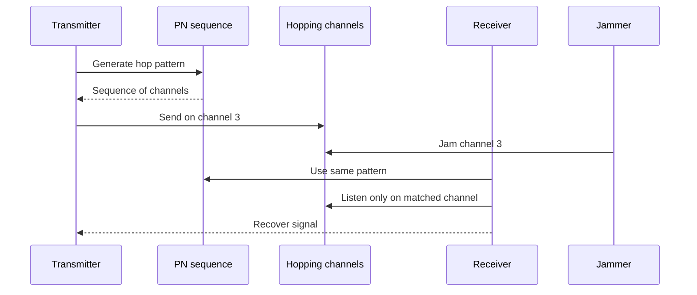

# 5) Frequency-Hopping Spread Spectrum (FHSS) and Anti-Jamming

## The visual idea

Instead of staying on one frequency, the signal jumps between channels in a pattern.

---

## What it is

Frequency-hopping spread spectrum (FHSS) is a technique where a signal rapidly changes carrier frequency according to a pseudo-random sequence.

The transmitter and receiver stay synchronized so they hop together.

---

## What it does

FHSS does two important things:
- spreads the signal over a large bandwidth
- makes narrowband interference less harmful

This is a powerful method against jamming and interference.

---

## How it does that

The project uses:
- an LFSR-based PN generator to create hop patterns
- BPSK modulation on each hop
- a receiver that de-hops the signal using the same pattern
- simulations with AWGN and jammers

The design also measures processing gain:

PG = 10 log10(N)

where N is the number of hopping channels.

A larger processing gain means better resistance to interference.

---

## Why this matters

A jammer often attacks one narrow frequency band. With FHSS, the signal moves continuously, so the jammer hits only a small fraction of the total transmission time and bandwidth.

This improves:
- anti-jamming performance
- interference tolerance
- link reliability under hostile conditions

---

## Why it matters in the project

This project is not only about good theoretical capacity; it also considers real-world robustness.

The project compares:
- BER under AWGN
- BER under tone jamming
- BER under partial-band jamming
- BER under fading conditions

That allows a full assessment of communication quality under difficult conditions.

---

## Project link to the design decision

FHSS affects the final system recommendation because a cellular design is not useful if it can support many users but cannot survive interference or jamming.

So the integrated planner checks not only capacity and reuse, but also anti-jamming benefit.

---

## Simple presentation version

> FHSS works by rapidly changing the transmitted signal among multiple frequencies using a pseudo-random pattern. Because of this, a jammer that attacks one channel affects only a small fraction of the message. In our project, FHSS is used to study how the wireless link performs under AWGN and jamming, and how that improves reliability in a real network.

