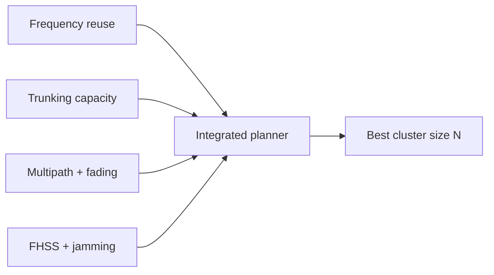

# 6) Integrated Planner: Turning All Topics into One Design Decision

## The visual idea

This is where the whole project comes together.

---

## What it is

The integrated planner is the final decision engine of the project.

It answers the central question:

> Which cluster size should be chosen for the network?

---

## What it does

The planner evaluates valid cluster sizes using multiple criteria:

- reuse distance
- co-channel interference
- outage probability
- Erlang-B capacity
- fading impact
- FHSS processing gain
- anti-jamming benefit
- supported users in the full network

Then it chooses the cluster size that gives the best overall tradeoff.

---

## How it does that

The code:
- iterates over cluster sizes
- computes SIR and outage values
- estimates capacity from Erlang-B
- considers path-loss and fading conditions
- includes the impact of hopping diversity and jammer resistance
- compares which design supports the most users while staying under the outage target

The final decision rule is essentially:

> choose the cluster size with the highest user support while keeping outage below the allowed threshold

---

## Why this matters

This is the “real engineering” portion of the project.

No single concept solves the entire problem. A good design needs:
- good reuse planning
- enough capacity
- low interference
- acceptable outage
- acceptable anti-jamming behavior

The planner combines all of those together.

---

## Why it matters in the problem statement

This is the exact answer to the project’s main problem:

> In a realistic wireless cellular system, which reuse pattern works best when all design constraints are considered together?

This is the final synthesis stage.

---

## Simple presentation version

> The integrated planner brings together all the different wireless concepts in the project and uses them to choose the best cluster size. It compares interference, capacity, fading outage, and anti-jamming performance to decide which network configuration gives the best overall design.

