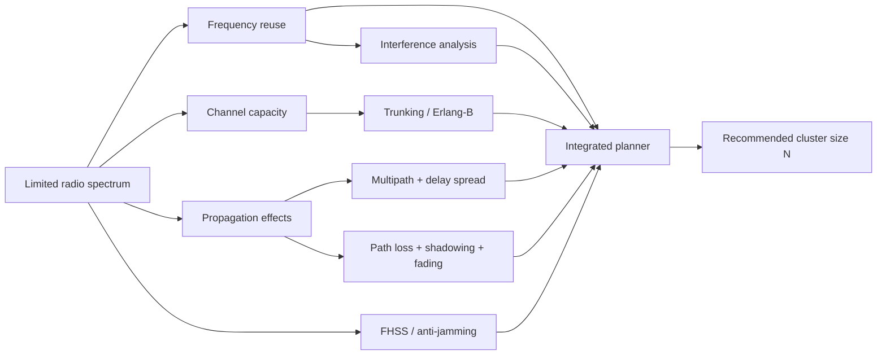
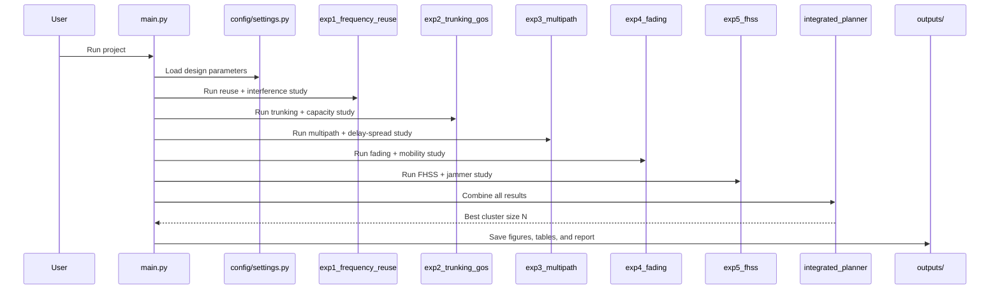

# CellHop Planner — Visual Explanation Guide

This folder turns a difficult wireless-communications project into a more understandable, presentation-friendly guide.

> The big question is simple:
>
> Which cluster size N should an 84-cell, 300-channel network use so that it can serve many users while keeping interference, fading, and jamming under control?

---

## The project in one picture

---

## Why this problem matters

A cellular network has a limited amount of radio spectrum. If the same frequency is reused too often, nearby cells interfere with each other. If it is reused too little, the network wastes spectrum and cannot serve as many users.

So the design must balance:

- Capacity: how many users can be served
- Interference: how much signal from other cells leaks in
- Reliability: how often the channel becomes weak or distorted
- Robustness: how well the system survives noise and jamming

This project combines all four into one design study.

---

## The six building blocks of the project

| Step | Topic | Why it matters |
|---|---|---|
| 1 | Frequency reuse | decides how often the same spectrum can be reused |
| 2 | Trunking / Erlang-B | tells how many users can be supported without too much blocking |
| 3 | Multipath delay spread | explains whether the channel is strongly distorted |
| 4 | Fading and Doppler | explains signal fluctuations with distance and motion |
| 5 | FHSS and jamming | shows how hopping helps resist interference |
| 6 | Integrated planner | combines them all into one final design choice |

---

## How the project flows

---

## Very short presentation version

> This project studies how to design a cellular wireless network under realistic constraints. It combines frequency reuse, capacity analysis, fading, propagation delay, and frequency-hopping spread spectrum to decide the best cluster size for the system. The goal is to maximize the number of users the network can support while keeping interference, signal degradation, and jamming under acceptable limits.

---

## Topic guide

- [01_frequency_reuse.md](./01_frequency_reuse.md)
- [02_trunking_erlang.md](./02_trunking_erlang.md)
- [03_multipath_delay_spread.md](./03_multipath_delay_spread.md)
- [04_fading_and_doppler.md](./04_fading_and_doppler.md)
- [05_fhss_and_jamming.md](./05_fhss_and_jamming.md)
- [06_integrated_planner.md](./06_integrated_planner.md)

---

## Presentation tip

If you are presenting in front of a class, start with this sentence:

> “This project is about designing a wireless cellular network that is both high-capacity and reliable.”

Then explain that the project does not look at a single formula; it combines several wireless-engineering ideas to answer one real design question.

